<div align="center">
  
</div>

<br />


### `> whoami`

# Olá, eu sou Matheus Nascimento.


Sou um entusiasta de tecnologia explorando o universo do desenvolvimento de software. Este perfil é o meu espaço para **aprender, experimentar e transformar ideias em projetos**.

```text
STATUS   aprendendo e construindo
MODO     curiosidade sempre ativa
MISSÃO   evoluir um commit por vez
```

[](https://github.com/m05241303)
[](https://github.com/m05241303?tab=repositories)


<br clear="right" />

---

## Tecnologias no radar

<div align="center">


</div>

## GitHub em números

<div align="center">
  
  
</div>

## Contribuições

<div align="center">
  <picture>
    <source media="(prefers-color-scheme: dark)" srcset="https://raw.githubusercontent.com/m05241303/m05241303/output/github-contribution-grid-snake-dark.svg" />
    <source media="(prefers-color-scheme: light)" srcset="https://raw.githubusercontent.com/m05241303/m05241303/output/github-contribution-grid-snake.svg" />
    
  </picture>
</div>

---

<div align="center">
  <sub>“Why so serious?” — código, caos e criatividade.</sub>
  <br /><br />
  
</div>
